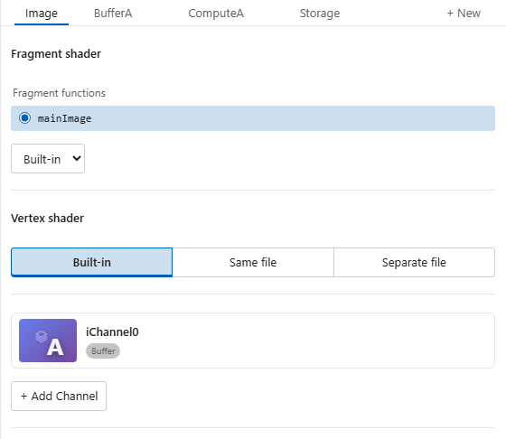
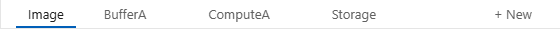

# Configure Passes and Inputs

The config panel is where you set up shader passes and choose their inputs. Everything is stored in a `.sha.json` file that the visual editor writes for you.

## Opening the Config Panel

Click the <i class="codicon codicon-gear"></i> **Config** button in the toolbar.



---

## The Pass Tab Bar

The tab bar at the top shows every pass in your shader. Click **+ New** to add a pass. Remove a pass with the `×` on its tab (Image cannot be removed).

**Right-click a tab** to open a context menu:

- **Open** — locks the shader and opens the pass's file in the editor
- **Rename** — inline rename for buffer passes (Image, Common, and Script cannot be renamed)



| Tab | Description |
|-----|-------------|
| **Image** | Always present. The final rendered output from the main shader file. Supports `mainImage` or a selected native WGSL/Slang fragment. No file chooser. |
| **Named buffer pass** | An intermediate fragment render pass backed by a `.glsl`, `.slang`, or `.wgsl` file. Names and pass counts are unrestricted. |
| **Compute pass** | A Slang or WGSL compute pass declared with `"type": "compute"` and backed by a `.slang` or `.wgsl` file. |
| **Common** | Shared functions, constants, and types used by other passes. |
| **Script** | A TypeScript or JavaScript file that drives custom `uniform` values per frame. |

!!! note
    Double-click a pass tab to open that pass's file — the shader locks automatically so the preview stays on your Image pass. You can also use the <i class="codicon codicon-lock"></i> **Lock** button manually. See [Locking](locking.md).

---

## The Image Pass

For WGSL and Slang render passes, **Render output** shows the active **Function**.
A single selected function appears as text; when more functions are available,
use the picker to choose which one renders. A missing configured function stays
visible with **(missing)** so you can correct it.

Choose **+ Add&hellip;** to insert either a **Native fragment function** or
**Built-in mainImage** into the pass's shader file. The built-in action is disabled
when `mainImage` is already present. Adding inserts code; picking a function
selects existing code. Changes are saved with the shader configuration.

The Image tab has no file path — it always corresponds to your main shader file. You can set a default resolution here:

| Setting | Options | Description |
|---------|---------|-------------|
| **Scale** | 0.25×, 0.5×, 1×, 2×, 4× | Relative to the panel size |
| **Aspect ratio** | 16:9, 4:3, 1:1, Fill, Screen | Constrains the canvas shape. Screen uses your screen's aspect ratio. |
| **Custom dimensions** | e.g. `1920 × 1080` | Base width and height in pixels |

The Image pass can also have input channels. GLSL and Slang access them by the
configured name, such as `iChannel0` or `iChannel1`; Slang also supports direct
channel methods such as `iChannel0.Sample(uv)`. WGSL uses its existing separate
texture/sampler handles and free functions such as `iChannel0Sample(uv)`. The
`.sha.json` field remains `inputs`. See [Channels](channels.md) for how to bind
textures, video, audio, and more.

See [Resolution](resolution.md) for how these settings interact with the toolbar.

- `scale` and `width` / `height` are composable. For example, `width: 320`, `height: 180`, `scale: 2` renders as `640 × 360`.

---

## Buffer Passes

Each buffer pass uses a `.glsl`, `.slang`, or `.wgsl` file to produce an image that other passes can sample. Buffer pass names are ordinary identifiers such as `Flow`, `BloomHorizontal`, or `BufferA`; there is no `BufferA`–`BufferD` name set or four-pass limit. Every pass can configure its own channels: GLSL uses `iChannelN` and `iChN`, Slang uses direct globals such as `iChannelN`, and WGSL uses free functions such as `iChannelNSample(uv)`. See [Channels](channels.md) for how to bind textures, video, audio, and more.

Choose **+ New → Cubemap** to create a cubemap buffer. Its Output section sets the square face size (512 pixels by default). To use the result, add a Buffer channel to a later pass and select the cubemap pass in **Misc**. Sample it with a three-component direction vector rather than a two-component UV coordinate. See [Cubemap Buffers](#cubemap-buffers) for a complete walkthrough.

The **File** row shows an editable path. **Change…** opens a chooser with files already used by the config, **Browse workspace…**, and **Create**. Several passes can use the same source file, each selecting a different function. Standalone’s Browse action selects files from its virtual workspace.

Three path forms are supported:

| Form | Example | Resolves relative to |
|------|---------|----------------------|
| Relative | `passes/flow.slang` | The main shader file |
| Absolute | `/Users/me/project/flow.glsl` | Filesystem root |
| Workspace-root | `@/src/flow.glsl` | VS Code workspace root (`/` of the virtual workspace in the standalone browser host) |

**Create** generates a source template using the shader mode preference. WGSL/Slang function rows appear under **Fragment shader**; choose the function this pass should run. **Add function…** inserts a hook or native entry point into that file, using the adjacent mode chooser. A native fragment can run without `mainImage`, and native templates use the generated vertex stage until you request a custom one. GLSL has no fragment function selector or Built-in/Native chooser because it uses the fixed `mainImage` hook.

The pass sections are arranged as Fragment source/functions, Channels, Geometry, Rendering, Resolution, Output, and Vertex shader. Image omits the file chooser. **Output** selects 2D or Cubemap, its cubemap face size, the buffer format, and read-only [inferred output slots and names](multiple-render-targets.md).

**Resolution** (optional) — by default a buffer inherits the Image pass resolution exactly. You can override this in two ways:

| Mode | Example | Description |
|------|---------|-------------|
| **Fixed** | `512 × 512` | Exact pixel dimensions, independent of the canvas |
| **Scale** | `0.5×` | Multiplier on the Image resolution — tracks canvas changes |

---

## Cubemap Buffers

A cubemap stores the view in six directions as six square faces. Use a cubemap buffer to generate an environment or reflection texture that other passes can sample. Its face size is independent of the preview canvas size.

GLSL fragment shaders and Slang fragment or compute shaders can generate cubemaps. WGSL cubemap generation is not supported yet.

### Create and Preview a Cubemap

1. Open a GLSL or Slang shader and choose **Config → + New → Cubemap**.
2. In the new pass, choose **File → Change… → Create** to create a starter shader, or choose an existing file containing `mainCubemap`.
3. In **Output**, set **Face size** (512 pixels by default).
4. In **Preview**, choose **Face**, **Cross layout**, or **Environment** to inspect the result. The starter colors each direction differently.
5. Choose **Image output** to return to your final shader image.

Changing the preview view does not change the saved shader configuration. Slang cubemap passes also offer **Cubemap execution** to choose Fragment or Compute.

### Write the Cubemap Shader

A fragment pass calls `mainCubemap` once per pixel of every face. `fragCoord` is the face pixel coordinate, `rayOri` is zero, and `rayDir` is the normalized sampling direction:

```glsl
void mainCubemap(out vec4 color, in vec2 fragCoord,
                 in vec3 rayOri, in vec3 rayDir) {
    color = vec4(rayDir * 0.5 + 0.5, 1.0);
}
```

```slang
float4 mainCubemap(float2 fragCoord, float3 rayOri, float3 rayDir) {
    return float4(rayDir * 0.5 + 0.5, 1.0);
}
```

### Sample the Cubemap in Another Pass

In the receiving pass, add a channel such as `iChannel0`, open **Misc**, and select the cubemap pass. In GLSL, sample it with `texture(iChannel0, direction)`; in Slang, use `iChannel0.Sample(direction)`.

For example, this GLSL Image shader views the cubemap along the positive Z direction. Place it in your main shader file after connecting `iChannel0`:

```glsl
void mainImage(out vec4 fragColor, in vec2 fragCoord) {
    vec2 uv = fragCoord / iResolution.xy * 2.0 - 1.0;
    vec3 direction = normalize(vec3(uv, 1.0));
    fragColor = texture(iChannel0, direction);
}
```

If you prefer to edit the configuration directly, save the cubemap shader as `environment.glsl` beside the main shader and use this `.sha.json` configuration:

```json
{
  "version": "1.0",
  "passes": {
    "Cubemap": {
      "path": "environment.glsl",
      "outputKind": "cubemap",
      "faceSize": 512
    },
    "Image": {
      "inputs": { "iChannel0": { "type": "buffer", "source": "Cubemap" } }
    }
  }
}
```

### Slang Compute Cubemaps

For a Slang compute cubemap, use `cubemapDirection(pixel.xy, face)` to get the direction for a face pixel and `writeOutput(pixel.xy, face, color)` to write its color. Face indices 0–5 are +X, −X, +Y, −Y, +Z, and −Z. The default **Output texels** dispatch covers all six faces; the Z coordinate identifies the face. `cubemapDirection` samples the center of the pixel.

### Limits and Feedback

Faces default to 512 pixels and are limited by the device's texture limits. Cubemap passes use fullscreen fragment rendering or Slang compute; custom vertex stages, mesh geometry, multiple outputs, 2D resolution settings, and per-layer channel selection are unavailable. Nearest and linear filtering use the base level; generated mipmaps are not provided.

For feedback effects, connect the cubemap pass to one of its own channels: it reads its previous frame, starting from a cleared image. Later passes read all six faces from the current frame. Changing **Face size** or pressing **Reset** clears the feedback history. Resizing the preview canvas keeps the configured face size.

---

## Per-Pass Geometry

Each buffer and Image pass can render with 2D or 3D geometry. Open the **Geometry** dropdown in the pass config to choose:

| Geometry | Description |
|----------|-------------|
| **Fullscreen** | One triangle covering the screen (default). Standard 2D shader rendering. |
| **Vertices** | Any number of vertices placed by the vertex shader, joined as triangles, lines, or points, in world space (seen by the orbit camera) or clip space (fixed on screen). Set **Vertices**, **Topology** and **Space** below the dropdown. |
| **Plane** | A flat 3D plane. |
| **Cube** | A unit cube centred at the origin. |
| **Sphere** | A UV-mapped sphere. |
| **Model** | A custom GLB mesh. |

The **Vertex shader** section appears last: after Resolution for Image and after Output for render buffers. Choose **Built-in**, **Same file**, or **Separate file**. Separate file shows its path and **Change…** chooser; Same file hides the duplicate path. Vertex function rows come from the selected vertex source. **Add function…** inserts into that source. GLSL shows only Add when `mainVertex` is missing, without a function selector or mode chooser. See [Vertex Shaders](vertex-shaders.md) for details on writing vertex shaders and the `mainVertex` API, and [Vertices geometry](vertex-shaders.md#vertices-geometry) for `vertexCount`, `topology` and `space`.

The **Rendering** section after Geometry sets the pass's **Blend** mode, and for every geometry but fullscreen its **Depth test**, **Depth write**, **Compare** and **Cull**. See [Render settings](vertex-shaders.md#render-settings).

## GPU Storage

The **Storage** tab opens a workspace with a buffer list and **Settings** / **Inspect** tabs. Apply pending settings from the header or below the form. See [GPU Storage](storage.md) for layouts, binary initial data, resets and read-only inspection.

## Compute Passes

Use **+ New → Compute** to add a compute pass, then use **File → Change…** to select, reuse, or create its `.slang` or `.wgsl` source. Choose a compute function row or use **Add function…**. Compute has Channels, Dispatch, Execution, and Output settings, with no Built-in mode, vertex stage, or geometry section.
See [Compute Passes](compute.md) for shader examples, storage buffers, and dispatch settings.

---

## The Script Pass

The Script pass drives custom `uniform` values per frame from a TypeScript or JavaScript file. Use it to animate parameters or bring external data into your shader.

### Exporting Uniforms

Your script must export a `uniforms(ctx)` function that returns an object:

```typescript
// shader.uniforms.ts
export function uniforms(ctx: {
  iTime: number;
  iFrame: number;
  iTimeDelta: number;
  iFrameRate: number;
  iResolution: [number, number, number];
  iMouse: [number, number, number, number];
  iDate: [number, number, number, number];
  iSampleRate: number;
  iChannelTime: [number, number, number, number];
}) {
  return {
    uSpeed:   ctx.iTime * 0.5,
    uColor:   [Math.sin(ctx.iTime), 0.5, 1.0] as [number, number, number],
    uEnabled: true,
  };
}
```

### Type Inference

Types are inferred from the return value on the first call. Use the returned names directly in your shader without declaring them.

| Return type | GLSL uniform |
|-------------|-------------|
| `number` | `uniform float uSpeed;` |
| `[n, n]` | `uniform vec2 uOffset;` |
| `[n, n, n]` | `uniform vec3 uColor;` |
| `[n, n, n, n]` | `uniform vec4 uRect;` |
| `boolean` | `uniform bool uEnabled;` |

WGSL and Slang shaders receive the same values as globals with the script's field names — no declaration needed. WGSL uses `f32`, `vec2<f32>`, `vec3<f32>`, `vec4<f32>`, and `bool`; Slang uses the corresponding `float`, `floatN`, and `bool` types.

### Polling Rate

The **Max Polling Rate** slider (1–120 fps) controls how often the script runs. The config panel shows the actual vs. target polling rate for each uniform.

For slowly-changing values, 1–10 fps is usually enough. High rates consume more CPU.

### Using Node.js APIs

Scripts run in Node.js and can `require()` any module. Modules resolve from the script file's own directory.

```typescript
import * as fs from 'fs';

export function uniforms(ctx) {
  const data = JSON.parse(fs.readFileSync('./params.json', 'utf8'));
  return { uValue: data.value };
}
```

Because the script runs in Node.js, you can pull in values from anywhere — game controllers, serial ports, external hardware, WebSockets, OS sensors, or any npm package. For example, you could read a gamepad with a library like `node-hid`, stream data from a microcontroller over serial, or poll an external API for live data.

!!! warning
    Do not name script uniforms the same as built-ins (`iTime`, `iResolution`, `iChannel0`, etc.). The script will fail to load with an error listing the collision.

---

## The Common Pass

Use the Common pass for shared utility functions, constants, and types. Select a `.glsl`, `.slang`, or `.wgsl` file written in the same language as your other passes.

=== "GLSL"
    ```glsl
    // shader.common.glsl — available in Image, BufferA, etc.
    #define PI 3.14159265359

    float hash(vec2 p) {
        return fract(sin(dot(p, vec2(127.1, 311.7))) * 43758.5453);
    }

    float noise(vec2 p) {
        vec2 i = floor(p);
        vec2 f = fract(p);
        float a = hash(i);
        float b = hash(i + vec2(1.0, 0.0));
        float c = hash(i + vec2(0.0, 1.0));
        float d = hash(i + vec2(1.0, 1.0));
        vec2 u = f * f * (3.0 - 2.0 * f);
        return mix(a, b, u.x) + (c - a) * u.y * (1.0 - u.x) + (d - b) * u.x * u.y;
    }
    ```

=== "Slang"
    ```slang
    // shader.common.slang — available in Image, BufferA, etc.
    #define PI 3.14159265359

    float hash(float2 p) {
        return fract(sin(dot(p, float2(127.1, 311.7))) * 43758.5453);
    }

    float noise(float2 p) {
        float2 i = floor(p);
        float2 f = fract(p);
        float a = hash(i);
        float b = hash(i + float2(1.0, 0.0));
        float c = hash(i + float2(0.0, 1.0));
        float d = hash(i + float2(1.0, 1.0));
        float2 u = f * f * (3.0 - 2.0 * f);
        return lerp(a, b, u.x) + (c - a) * u.y * (1.0 - u.x) + (d - b) * u.x * u.y;
    }
    ```

You can then use `hash`, `noise`, or `PI` in any Image or named buffer pass.

!!! note
    Common provides shared code; it does not produce an image of its own.

---

## Other: Editing the Config File Directly

The config is stored as JSON in a `.sha.json` file with the same base name as the shader (`myshader.glsl`, `myshader.slang`, or `myshader.wgsl` → `myshader.sha.json`), in the same directory. You can edit it directly in VS Code, and the Config panel stays in sync with the file.

See [Config File Format](../help/config-file.md) for the full schema reference.

## Next

[Channels](channels.md) — bind textures, video, audio, cubemaps, buffers, and keyboard input
