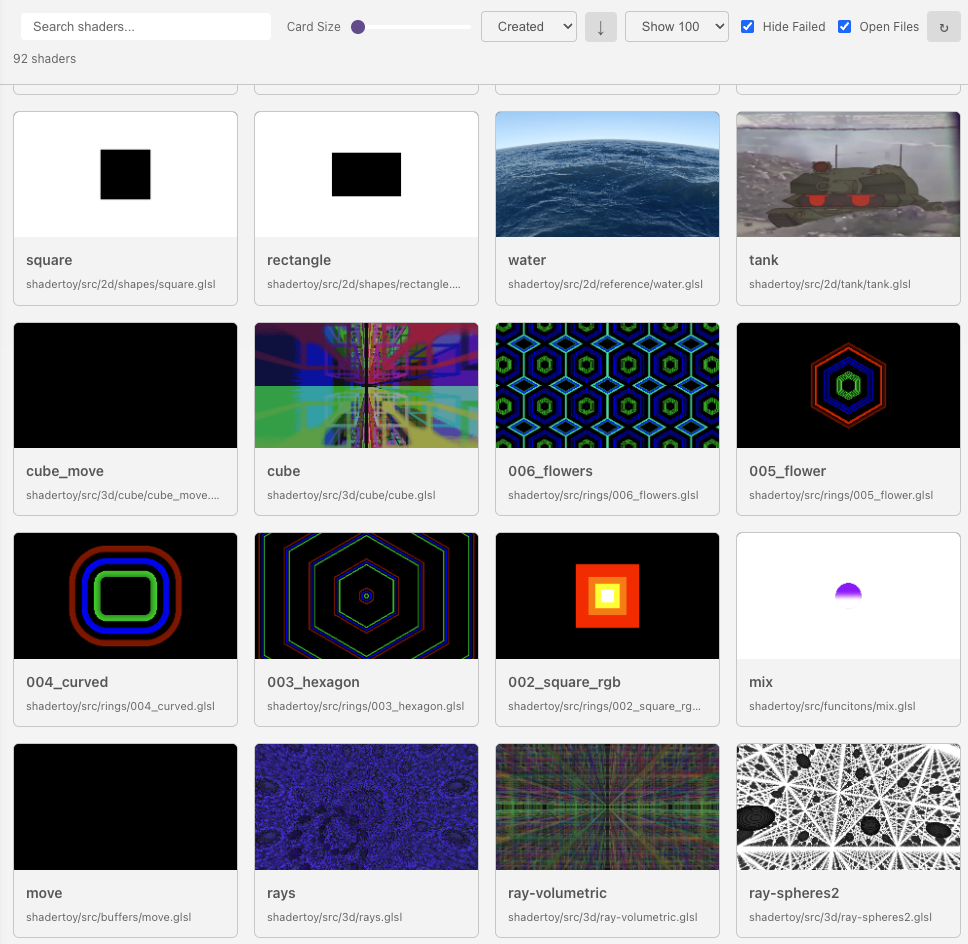

# Shader Explorer

Shader Explorer lets you browse, search, and preview all shader files in your workspace.

## Opening

The Shader Explorer is available in two forms — the **sidebar** for persistent browsing, and the **full panel** for focused exploration.

- **Sidebar** — click the  **Shader Studio** icon in the VS Code activity bar. The explorer appears as a sidebar view you can keep open alongside your editor.
- **Full panel** — open the toolbar menu and choose **Shader Explorer**, or run **Shader Studio: Open Shader Explorer** from the command palette.

Each view remembers its own search, sorting, page, and card-size choices.

## Browsing and Navigation

Each shader in your workspace appears as a card showing a live-rendered thumbnail preview, the shader filename, and its last-modified date.

- **Click a card** to open the shader file in the editor and refresh its thumbnail preview.
- **Right-click a card** to open a context menu with options to open the shader, open its config, or delete it.
- **Open file when selecting a shader** — when enabled, clicking a card opens the shader file in the editor. Turn this off to change the preview without opening its file. This control is hidden while **Only keep active shader files open** manages the editor tabs.

## Keep Files with Their Preview

Open **Explorer settings** (the gear button), find **Files**, and enable **Only keep active shader files open**. It is **on by default in standalone** and **off by default in VS Code**. VS Code also exposes it as `shader-studio.explorer.keepActiveShaderFiles` in Settings.

The active preview opens its main shader, linked buffer, Common and vertex sources. The `.sha.json` config is not opened automatically. Switching to another shader opens that shader's files and closes shader tabs outside the active previews, including shader files you opened separately. Closing a tab does not delete its file. Other tabs, such as notes or a README, stay open.

In VS Code, each preview maintains its own editor group. With two previews, switching one replaces its file set while the other preview's files stay open. A locked preview keeps its own files until its displayed shader changes or the preview closes. Standalone currently provides one preview pane.

If an old file has **unsaved changes**, closing it asks first. VS Code uses its usual save dialog; **Cancel** keeps that file open. Standalone normally saves automatically, but pending or failed saves prompt you to save and close; cancelling or a failed save keeps the file open. Saved files close without a prompt. Cancelling does not undo the preview switch.

Turning the setting off leaves the current tabs open and stops managing them. The feature uses each preview's known source files; it does not search other shaders' configs to guess ownership.

## Search and Sort

- **Search** — type in the search bar to filter shaders by name, path, or shader source text (case-insensitive). Name matches are shown before path and source-text matches. Multiple terms are combined, quoted phrases match exactly, and terms prefixed with `-` are excluded, e.g. `ray sphere -buffer` or `"ray march"`.
- **Sort by** — dropdown with options:
    - **Name** — alphabetical A–Z
    - **Updated** — most recently modified first
    - **Created** — newest first
- **Sort order** — toggle button to switch ascending/descending

## Display Options

Click the gear button to open **Explorer settings** over the shader list. Settings are grouped into **Display**, **Filters**, and **Files** and save immediately. Close with the × button, Escape, or a click outside. **Reset to defaults** restores all Display, Filters and Files options, including the host-specific default for active shader files.

- **Card size** — slider (100–1000px width) to control how large shader cards appear. Only available in grid layout mode.
- **Layout** — toggle between **Grid** (cards in a responsive grid) and **List** (cards in a single-column list with larger thumbnails).
- **Per page** — dropdown to show 10, 20, 30, 50, or 100 shaders per page.
- **Hide buffer files** and **Hide vertex files** — hide matching buffer and vertex filenames from the explorer.
- **Hide failed previews** — checkbox to hide shaders that failed to compile or render.
- **Open file when selecting a shader** — controls whether clicking a card opens its file when automatic file management is off.
- **Only keep active shader files open** — opens and retires file sets with the active previews, as described above.

## Refresh

Click the **refresh button** in the toolbar to re-scan the workspace for shaders and regenerate all thumbnails.

Clicking an individual shader card also refreshes that shader's thumbnail — useful after editing a shader to update its preview in the explorer.

## File Management

- **New shader** — click the **+** button in the toolbar to create a new shader file from a template.
- **Delete shader** — right-click a card and choose **Delete** to move the shader file to the trash. If the shader has dependent buffer pass files, a confirmation dialog warns you before deleting.

## Next

[Code Snippets](code-snippets.md) — insert bundled shader code through native VS Code completion
